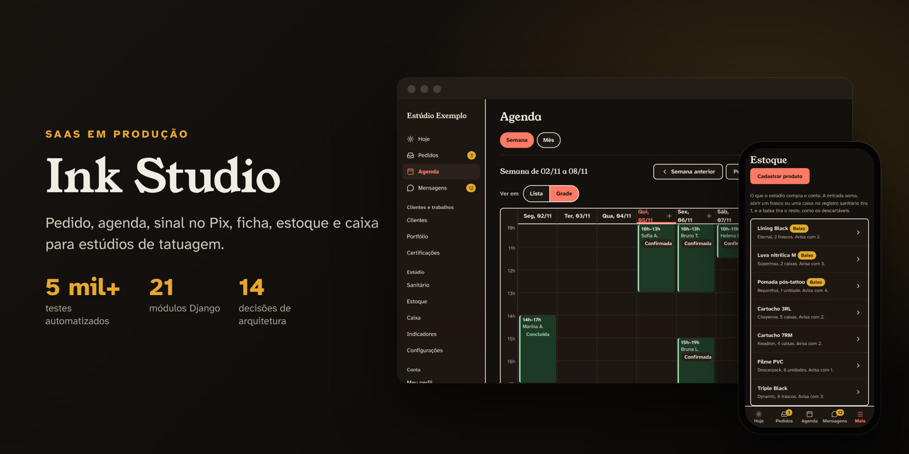
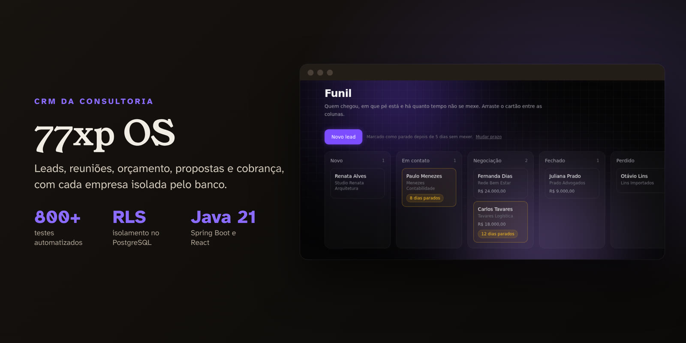

 

 

## 🙋 Sobre mim

Desenvolvedor backend com **Java e Spring Boot** e **Python e Django**. No **TJDFT**, sou estagiário
de TI na área de Dados: trabalho com dados institucionais em **Oracle Database** num ambiente de
produção e automatizo o que antes era conferência manual.

Vim da infraestrutura (redes, manutenção e segurança no técnico), e por isso penso em falha,
migração e operação antes de pensar em funcionalidade. O que mais gosto de garantir: a regra
importante fica no banco, e não só na tela, e o erro aparece no teste antes de chegar ao usuário.

Fundei a **77xp** e mantenho plataformas próprias no ar, do levantamento de requisitos ao deploy.
Procuro minha primeira posição efetiva como desenvolvedor **backend, de dados ou de infraestrutura**.

 

## 🛠️ Tecnologias & Ferramentas

**Linguagens**

**Back-end & Front-end**

**Bancos de dados**

**Testes & Qualidade**

**Dados & Automação**

**Infraestrutura & Deploy**

 

## 🚀 Projetos em destaque

<table>
<tr>
<td width="50%" valign="top">

### 🎨 Ink Studio

SaaS para estúdios de tatuagem, **em produção e com assinatura paga**: orçamento com o mapa do
corpo, agenda, sinal por Pix, ficha e termo digitais, registro sanitário, caixa e estoque.

- **Multi-tenant**, com um teste que tenta abrir cada página com os dados de outro estúdio
- **Regras no banco:** o PostgreSQL impede dois horários sobrepostos, e o estoque nunca fica negativo
- **Pix** pelo Mercado Pago, com o aviso conferido por assinatura HMAC e sem duplicar

**5 mil+** testes · **21** módulos · **121** migrações · **14** decisões de arquitetura

Código privado (produto comercial)

</td>
<td width="50%" valign="top">

### 🏛️ Cátedra

Plataforma de cursos online, **no ar como Aprovação Passo a Passo**, para concursos bancários. Da
vitrine ao certificado: venda, área do aluno, correção de redação e painel do professor.

- **Acesso só com pagamento confirmado** direto com o provedor; o estorno revoga sozinho
- **18 módulos** com fronteiras verificadas pelo ArchUnit a cada build
- **JWT** com refresh rotativo, senhas em Argon2id e e-mail no padrão outbox

**400+** testes · **18** módulos · **37** migrações Flyway · **3** ambientes na mesma API

Código privado (projeto de cliente)

</td>
</tr>
<tr>
<td width="50%" valign="top">

### 📈 77xp OS

O sistema que opera a 77xp: leads, reuniões, orçamento, propostas e cobrança. O cliente abre a
proposta por um link público, e o site da 77xp manda cada lead direto para o funil.

- **Isolamento pelo banco:** Row Level Security em toda tabela; consulta sem filtro não vaza nada
- **Auditoria só de inserção**, com `UPDATE` e `DELETE` revogados no banco
- Testes da API contra **PostgreSQL de verdade**, com Testcontainers

**800+** testes · **RLS** em toda tabela · site, painel e API

Código privado

</td>
<td width="50%" valign="top">

### 📅 Agenda por WhatsApp com IA

Para uma assessoria de licitações: o pedido **encaminhado ao WhatsApp do robô** vira evento no
Google Agenda, com resposta na conversa, alarmes no celular e lembretes por e-mail.

- **A IA lê, o código confere a data:** na dúvida, o evento nasce vermelho para alguém conferir
- **Falha que avisa:** áudio, pedido sem data ou IA fora do ar viram aviso na hora
- Lógica em JavaScript **fora do n8n**, para poder testar

**47** testes · **3** entradas (WhatsApp, Gmail e formulário) · **R$ 0** de infraestrutura

</td>
</tr>
</table>

 

## 📂 Outros projetos

| Projeto | O que é | Stack | |
|:---|:---|:---|:---:|
| **[Extrator auditável](https://github.com/kauaxp77/AutomatizacaoDeDados)** | Extração de sistemas legados com validação por backtest: 97,6% de acurácia contra 84 registros feitos à mão | `Python` `Playwright` | |
| **[Simulados SEDES-DF](https://github.com/kauaxp77/simulados-sedes-df)** | Simulados com papéis validados nas regras do Firestore e auditoria por triggers | `Firebase` `Cloud Functions` | [🔗](https://simulados-sedes-df.vercel.app) |
| **[Carlos Rosa](https://github.com/kauaxp77/Carlos-Rosa)** | Site de fotógrafo com CMS próprio, agendamento e auditoria | `Java 21` `Spring Boot` `MySQL` | |
| **[MedClin](https://github.com/kauaxp77/Medclin)** | Gestão de clínica com três perfis, relatórios em PDF e gráficos | `PHP` `MySQL` `Chart.js` | |
| **[HireNow](https://github.com/kauaxp77/Hirenow-Job)** | Portal de vagas com área da empresa e conversa com o candidato | `PHP` `MySQL` | |
| **[Agendamento de Salas](https://github.com/kauaxp77/Agendamento-de-Salas)** | Reserva de salas do SENAI | `PHP` `MySQL` `Bootstrap` | |
| **[Calculadora de orçamentos](https://github.com/kauaxp77/calculadora-orcamentos)** | Orçamento de projeto com PDF assinado e envio pelo WhatsApp | `JavaScript` `Firebase` | [🔗](https://calculadora-or-amentos-bay.vercel.app) |
| **[ASSED Goiás](https://github.com/kauaxp77/ASSEDGOIAS)** | Protótipo de front-end: site, área do associado e painel | `React` `TypeScript` `Vite` | [🔗](https://assedgoias.vercel.app) |
| **[Requinte Coffee](https://github.com/kauaxp77/Requinte_coffee)** | Página de venda de um buffet de café | `Next.js` `Tailwind` | [🔗](https://requinte-coffee.vercel.app) |
| **[Sistema de Patrimônio](https://github.com/kauaxp77/Sistema_Patrimonio)** | Telas de gestão de unidades, setores e relatórios patrimoniais | `HTML` `SCSS` `JavaScript` | |

 

## 🎓 Formação

| | Curso | Instituição | |
|:---:|:---|:---|:---|
| 🎓 | **Análise e Desenvolvimento de Sistemas** | UniProjeção | 4º semestre · previsão **07/2027** · CRA **7,88** |
| 🖥️ | **Técnico em Informática** | Escola Técnica de Ceilândia | concluído em 2024 |

**Certificações:** Oracle APEX Foundations · MongoDB Overview · Power BI

 

## 📊 GitHub

 

  

